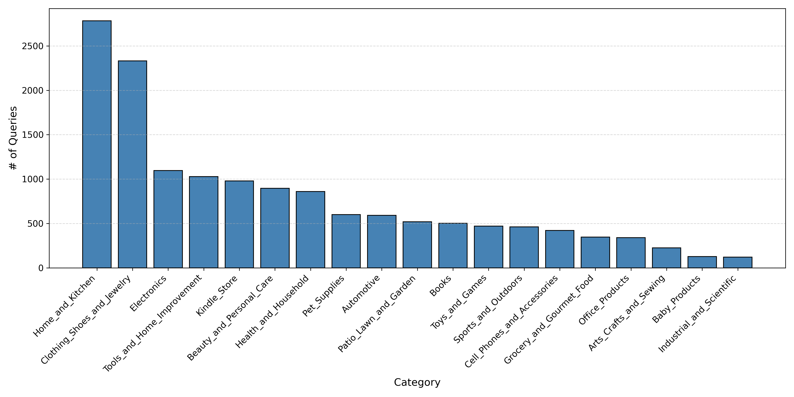
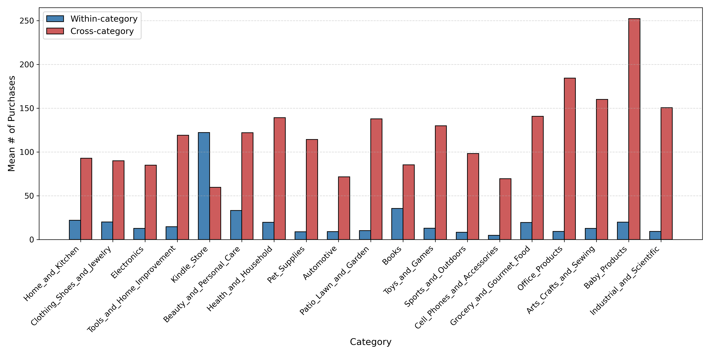

---
datasets:
- data-for-review
language:
- en
license: cc-by-4.0
task_categories:
- text-retrieval
- text-ranking
tags:
- amazon-c4
- e-commerce
- user-history
- reranking
- personalization
---

# Amazon-C4 User Purchase History Dataset

A large-scale dataset of user purchase histories paired with e-commerce search queries, designed for personalized product reranking research. This release contains user purchase histories organized by product category and synchronized with Amazon-C4 queries.

## Table of Contents

- [Overview](#overview)
- [Statistics](#statistics)
- [Quick Start](#quick-start)
- [Source Data](#source-data)
- [Files](#files)
- [Row Schema](#row-schema)
- [Query Text Lookup](#query-text-lookup)
- [License](#license)
- [Acknowledge](#acknowledge)

## Overview

This dataset contains release-ready user purchase histories for Amazon-C4 queries, grouped by product category. Each query is paired with the user's complete purchase history up to the point of the target purchase, enabling research in personalized reranking and preference-based recommendation systems.

## Statistics

In this dataset, we categorize queries based on the category of their positive product. We then analyze the distribution of user purchase histories across within-category (same category as the positive product) and cross-category (different categories) purchased products.

### Dataset Composition

- **Number of Product Categories:** 28
- **Dataset Splits:** Train, Dev, Test
- **Query Integration:** Amazon-C4 queries with rewritten variants
- **History Organization:** Grouped by Amazon Reviews 2023 product categories
- **Coverage:** Users paired with their temporal purchase histories up to target purchase time

### Query Distribution by Category

Distribution of queries across product categories (excluding categories with fewer than 100 queries for clarity):



### Within-Category vs. Cross-Category Product Distribution

For each category, the figure below shows the average count of within-category and cross-category products in user purchase histories. The categories and their order correspond to the query distribution figure above:



## Source Data

This release is derived from two public datasets:

- Amazon-C4: product-search queries, positive products, and product metadata. See the [Amazon-C4 Hugging Face dataset](https://huggingface.co/datasets/McAuley-Lab/Amazon-C4) and the associated paper, [Bridging Language and Items for Retrieval and Recommendation](https://arxiv.org/abs/2403.03952).
- Amazon Reviews 2023: user review/purchase records, product categories, timestamps, and `verified_purchase` flags. See the [Amazon Reviews 2023 project page](https://amazon-reviews-2023.github.io/) and the [Amazon Reviews 2023 Hugging Face dataset](https://huggingface.co/datasets/McAuley-Lab/Amazon-Reviews-2023).

The construction follows the dataset-building procedure described in the paper. For each Amazon-C4 query, the associated user and positive product are used to recover the user's historical interactions from Amazon Reviews 2023. The history is sorted by timestamp and cut off at the first purchase time of the positive product, so only interactions at or before the target purchase event are considered. The resulting history is grouped by Amazon Reviews 2023 product category.

## Files

### Directory Structure

```text
cutoff_group_user_history_by_category_release/
  <Category>/
    train.jsonl
    dev.jsonl
    test.jsonl
  amazon_c4_user_query_dict_o3-mini_rewritten_v2.json
  cutoff_group_user_history_summary.json
  cutoff_group_user_history.jsonl
  README.md
```

### File Descriptions

**Category Folders:**
Each category folder (`<Category>/`) contains JSONL files for the three dataset splits:
- `train.jsonl`: Training set with queries and user purchase histories
- `dev.jsonl`: Development/validation set
- `test.jsonl`: Test set

All files contain one JSON object per line.

**amazon_c4_user_query_dict_o3-mini_rewritten_v2.json:**
A companion dictionary mapping query identifiers to both original and rewritten query text. For each query of `Electronics` and `Beauty_and_Personal_Care`, the dictionary stores:
- `amazon-c4`: The original Amazon-C4 query text
- `o3-mini`: The rewritten query text

The rewritten queries follow the [MR.REC](https://arxiv.org/abs/2406.11218) approach, simplifying queries to their core intent using the o3-mini language model. The rewriting process uses the following system and user prompts:

```
# system prompt
Rewrite the "Original Query" into a single, casual, conversational query. Rules:
- Keep: 1 core item + 1 core use case (e.g., "a laptop for gaming").
- Delete: All other details (including brand, specs, price, personal preferences, etc.).
- Tone: Natural and conversational.
- Format: Must be a single sentence.

# user prompt
Original Query: {query}
Rewritten Query:
```

This approach ensures queries focus on essential information while maintaining a natural, conversational tone suitable for reranking evaluation.

**cutoff_group_user_history_summary.json:**
Contains processing statistics and validation counts for all category/split files, providing metadata about dataset composition and quality assurance metrics.

**cutoff_group_user_history.jsonl:**
A consolidated JSONL file containing the complete dataset from all category-specific train/dev/test splits combined. This unified file provides a convenient single-file view of the entire dataset without category partitioning, useful for full-dataset analysis and experiments that don't require category-stratified splits.

## Row Schema

Each row in `train.jsonl`, `dev.jsonl`, or `test.jsonl` has the following fields:

```json
{
  "user_id": "...",
  "query": 8860,
  "pos_product": "B0C5PHZ4QS",
  "pos_product_category": "Electronics",
  "grouped_purchase_history": {
    "Electronics": [
      ["B08...", 1680000000000, true]
    ],
    "Home_and_Kitchen": [
      ["B09...", 1670000000000, false]
    ]
  }
}
```

Field meanings:

- `user_id`: Amazon Reviews 2023 user identifier.
- `query`: Amazon-C4 query id (`qid`).
- `pos_product`: Amazon-C4 positive product id / Amazon parent ASIN.
- `pos_product_category`: target product category after mapping Amazon-C4 categories to Amazon Reviews 2023 categories.
- `grouped_purchase_history`: user history grouped by category. Each history item is `[parent_asin, timestamp_ms, verified_purchase]`.

The `verified_purchase` flag is preserved from Amazon Reviews 2023. The release does not filter history items to verified purchases only.

Product ids in this release are Amazon parent ASINs. The `pos_product` field and each history item's `parent_asin` can be used to locate the corresponding product metadata in the Amazon Reviews 2023 item metadata files.

## Quick Start

### Loading the Dataset

```python
import json

# Load a category's training data
with open('Electronics/train.jsonl', 'r') as f:
    for line in f:
        record = json.loads(line)
        print(record)
```

### Accessing Query Text

```python
import json

# Load the query dictionary
with open('amazon_c4_user_query_dict_o3-mini_rewritten_v2.json', 'r') as f:
    query_dict = json.load(f)

# Load a record and access its query text
with open('Electronics/train.jsonl', 'r') as f:
    for line in f:
        record = json.loads(line)
        key = f"{record['user_id']}-{record['query']}-{record['pos_product']}-{record['pos_product_category']}"
        
        original_query = query_dict[key]["amazon-c4"]
        rewritten_query = query_dict[key]["o3-mini"]
        print(f"Original: {original_query}")
        print(f"Rewritten: {rewritten_query}")
        break  # Just show first record
```

### Exploring the Data

```python
# Check dataset statistics
with open('release_summary.json', 'r') as f:
    summary = json.load(f)
    print(summary)
```

## License

This dataset is licensed under the [Creative Commons Attribution 4.0 International License (CC-BY-4.0)](https://creativecommons.org/licenses/by/4.0/). See the [LICENSE](LICENSE) file for details.

## Acknowledge

- Amazon-C4: https://huggingface.co/datasets/McAuley-Lab/Amazon-C4
- Amazon Reviews 2023: https://huggingface.co/datasets/McAuley-Lab/Amazon-Reviews-2023
